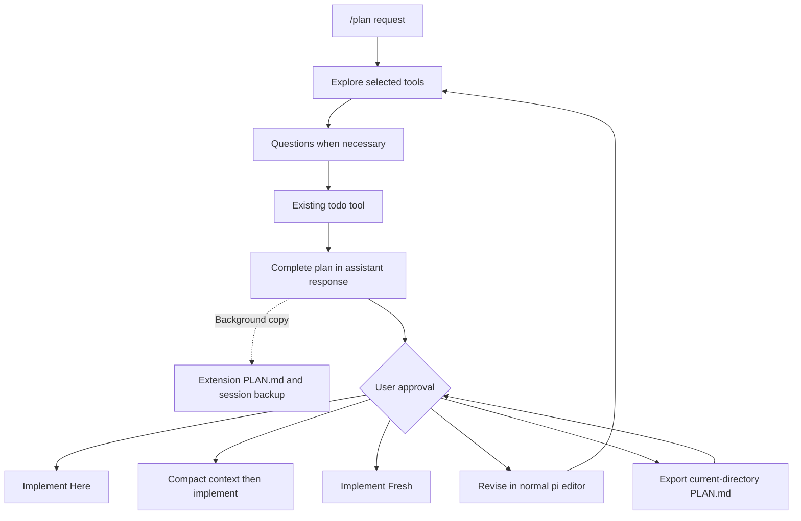

# Plan Mode for pi

This extension provides a plan-first workflow with explicit approval. It uses the existing question and todo tools. It does not register new tools.

## Commands

- `/plan [prompt]` starts Plan Mode and sends the prompt to the agent.
- `/plan` without a prompt starts Plan Mode, or opens approval for a ready plan.
- `/plan settings` opens the five configuration options.
- `/plan exit` exits Plan Mode, restores the tools and thinking level from before planning, and keeps the plan in the session.

Plan Mode remains active until you approve implementation or run `/plan exit`. Escape closes an approval dialog without approval. The extension exposes no other nested commands or keyboard shortcuts.

## Workflow



The assistant writes the complete plan in the active conversation. The extension recognizes an explicit completion marker at the end of a successful response. Interim text, tool calls, errors, and aborted responses do not authorize approval.

### Approval options

| Option                                 | Result                                                                                                                                                                                                      |
| -------------------------------------- | ----------------------------------------------------------------------------------------------------------------------------------------------------------------------------------------------------------- |
| **Implement Here**                     | Restore the tools from before Plan Mode. Apply the implementation model and thinking level. Start in the current session. Remove internal backups after the implementation prompt is recorded.              |
| **Implement Here and Compact Context** | Complete compaction first. Insert the exact approved plan again, apply implementation settings, and start implementation. Remove internal backups after the prompt is recorded.                             |
| **Implement Fresh**                    | Create a parent-linked session. Apply implementation settings in the new runtime. Send the full approved plan without the research conversation. Remove the source backup after the new prompt is recorded. |
| **Revise the Plan**                    | Return to the normal pi editor. Submit changes to request a complete replacement plan. All pi slash commands remain available.                                                                              |
| **Export the Plan**                    | Write the exact plan to `PLAN.md` in the current directory. Ask before replacement. Keep Plan Mode active.                                                                                                  |

If compaction fails or you cancel it, implementation does not start. If the selected model is unavailable or lacks authentication, implementation does not start. Use `/plan` to open approval again.

## Settings

Settings persist in `agents/pi/plan-mode-settings.json` in dev-config. The installer symlinks `~/.pi/agent/plan-mode-settings.json` to that tracked file. Changes from `/plan settings` update the repo copy. These settings share enabled tool names and the bash whitelist; do not enable commands or tools you do not trust.

1. **Tools selection**: A searchable checkbox list contains all registered tools, including MCP tools. Read-only annotations and known read tools default to ON. Existing `ask_user_question`, `questionnaire`, and `todo` also default to ON, as approved workflow exceptions. All other tools default to OFF. Hidden tools remain unavailable.
2. **Bash whitelist**: Edit literal command prefixes, one per line. The initial list includes file inspection and restricted Git inspection commands. Bash itself defaults to OFF.
3. **Default thinking for Plan Mode**: Default is `inherit`. You can select a specific thinking level. Pi clamps the level to the model capability.
4. **Implementation model**: Default is `inherit`, which restores the model from before Plan Mode. A selected model applies to all three implementation actions.
5. **Implementation thinking**: Default is `inherit`, which restores the level from before Plan Mode. A selected level applies to all three implementation actions.

For tools, use the arrow keys to navigate and Space to toggle a checkbox. Follow the on-screen instructions to save or cancel. Each option includes a description. RPC uses supported dialogs instead of terminal components.

When settings change during Plan Mode, the extension updates the tool selection. Otherwise, a plan keeps its selected tool names. A newly discovered tool does not gain permission silently.

### Bash examples

With bash ON, these default commands are permitted:

```sh
ls -la
rg 'pattern' src
find src -name '*.ts'
git --no-pager status
git --no-pager diff --no-ext-diff --no-textconv
```

Each command in a pipeline or command chain must match an allowed prefix. Shell substitutions, redirections, unquoted glob patterns, background execution, escapes, and unsupported syntax are blocked. Quote glob patterns, as in `find src -name '*.ts'`. Known destructive flags, such as `find -delete`, are blocked.

To permit only a version check, add `bun --version`, not `bun`. A broad prefix permits all subsequent arguments, except the explicit blocked flags.

**CAUTION: This policy is not an operating-system sandbox.** Tool annotations are hints, not verified guarantees. Custom tools, subagents, shell aliases, and manually allowed interpreters can have side effects. Enable only tools and commands that you trust. Nested calls through pi's tool API use the same permission checks. A tool that performs direct internal work cannot expose that work to those checks.

## Backups and recovery

The extension immediately appends plan state to the session branch. A separate queue writes backups with atomic replacement and private file permissions:

```text
plan-mode/
├── PLAN.md                         latest complete plan
└── state/<session-id>/
    ├── PLAN.md                     this session's complete plan
    └── recovery.json               session ID, cwd, and state
```

These generated files are gitignored. Backups contain plan text and can contain sensitive project details. Protect the extension directory accordingly. Background writes are best effort. A process crash before a write completes can leave the previous backup.

After an implementation prompt is recorded in the target session, the extension removes that session's `PLAN.md` and `recovery.json`. It also removes the extension-level `PLAN.md` when it matches the approved plan, unless that file is also the current-directory export. If authentication or compaction fails first, the internal backup remains for another approval attempt. `/plan exit` keeps the plan and its backup because it does not approve implementation.

Session recovery uses the active branch, not abandoned branches. An intact session restores its proposed plan and approval state. Disk recovery only applies when session state is missing and the session ID and working directory match. A recovered disk plan requires the agent to publish a complete plan in the conversation before approval. The extension never substitutes `cat PLAN.md` for an assistant response.

No startup action resumes implementation automatically. Fresh-session approval leaves the source plan in its original session. The source backup is removed after the fresh session records the implementation prompt.

## Installation

Install the bundled extensions from GitHub:

```sh
pi install git:github.com/caturbgs/pi-extensions
```

This package loads Plan Mode, Notify, and Titlebar Spinner together. The dev-config installer no longer links extension source files directly; its Pi configuration remains symlinked from dev-config. Plan Mode preferences remain in `agents/pi/plan-mode-settings.json`, symlinked to `~/.pi/agent/plan-mode-settings.json`, so `/plan settings` continues to update the tracked dev-config file.

For one invocation during development, load Plan Mode directly from the package root:

```sh
pi -e ./extensions/plan-mode/index.ts
```

Use `/reload` or restart pi after installation. This extension targets `@earendil-works/pi-coding-agent`, including its nested-tool hooks and fresh `withSession` context.

From the package repository root, install development dependencies with Bun and run:

```sh
bun install
bun run test
bun run check
bun run format:check
```

Pi supplies the peer packages at runtime. Standalone tests need those packages available to the module resolver. A local `node_modules` symlink to the host installation can provide them without duplicate copies. Atomic settings saves resolve symlinks so they update the tracked target.

Workflow tests use a mock approval dialog. UI tests run in a separate process to prevent mock leakage.

## References

- [OMP Plan Mode documentation](https://omp.sh/docs/plan)
- [OMP Plan Mode source](https://github.com/can1357/oh-my-pi/tree/main/packages/coding-agent/src/plan-mode)
- [@narumitw/pi-plan-mode](https://github.com/narumiruna/pi-extensions/tree/main/packages/pi-plan-mode)
- [Pi Plan Mode example](https://github.com/earendil-works/pi/tree/main/packages/coding-agent/examples/extensions/plan-mode)
